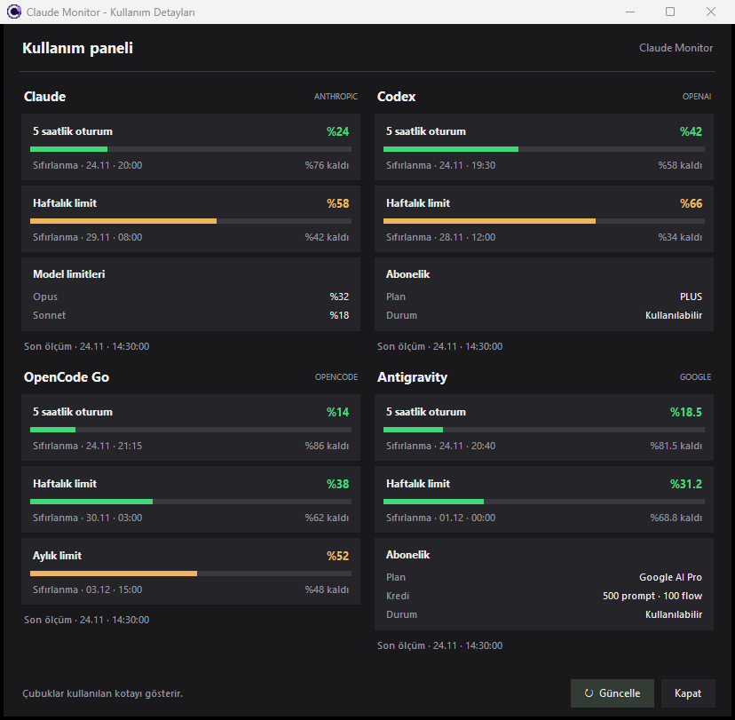

# Claude Monitor (v1.4.0)

Windows 11 system tray app that tracks your [Claude.ai](https://claude.ai), [Codex](https://chatgpt.com/codex) (ChatGPT), [OpenCode Go](https://opencode.ai/docs/go/), and [Antigravity](https://antigravity.google) (Google) usage quotas in real time.

See [CHANGELOG.md](CHANGELOG.md) for release notes.



## Features

- **System tray icon**: outer ring split into 4 equal quadrant arcs (top-right Claude, bottom-right Codex, bottom-left OpenCode Go, top-left Antigravity), each color-coded (green -> orange -> red), with Claude 5-hour quota % in the center
- **Codex / ChatGPT quota**: reads the OAuth token from `~/.codex/auth.json` (no extra setup if Codex CLI or the Codex app is logged in) and shows the 5-hour and weekly windows
- **OpenCode Go quota**: uses OpenCode's signed-in Account session to show 5-hour, weekly, and monthly usage
- **Antigravity (Google) quota**: reads the 5-hour and weekly quota windows, plan name, and prompt/flow credit balance directly from the local Antigravity language server on `127.0.0.1` (proxy disabled; CSRF token and e-mail are never logged or stored)
- **Hover tooltip**: compact `CL / CX / Go / AG` utilization that always fits within Windows' 127-character tray tooltip limit
- **Click to open**: 2x2 grid usage window with progress bars, model-specific limits, credits, and reset timestamps
- **Desktop notification**: Windows toast when usage crosses the configurable threshold (default 75%); OpenCode Go and Antigravity check each window independently per period
- **Auto-refresh**: polls every 2 minutes; manual refresh button in detail window
- **Auto-start**: optional Windows startup shortcut

## Requirements

- Windows 10/11
- Python 3.10+
- Claude.ai account (Free, Pro, or Max plan)
- Optional: Codex CLI or Codex app logged in with a ChatGPT account (for Codex quota)
- Optional: OpenCode logged in with an OpenCode Go Account (for OpenCode Go 5-hour, weekly, and monthly quotas)
- Optional: Antigravity IDE / desktop app running locally (for Antigravity 5-hour, weekly, plan, and credit quotas)

## Installation

```bat
git clone https://github.com/muratkoseonline/claude-monitor.git
cd claude-monitor
setup.bat
```

## Usage

```bat
run_background.bat    # start silently (no console window)
run.bat               # start with console (debug)
```

On first run, right-click the tray icon → **Ayarlar** and enter your session key.

### Getting your session key

1. Open [claude.ai](https://claude.ai) in your browser
2. Press **F12** → Application → Cookies → `https://claude.ai`
3. Copy the value of `sessionKey` (starts with `sk-ant-…`)
4. Paste it into Claude Monitor → Settings

> **Note:** Session keys expire after a few weeks. If the icon shows `ERR`, get a fresh key.

### Codex (ChatGPT) quota

Nothing to configure. If Codex CLI or the Codex desktop app is logged in, the token in `%USERPROFILE%\.codex\auth.json` is used automatically. If the Codex section shows an auth error, run `codex login` again. You can disable it or point to a different `auth.json` in Settings.

### OpenCode Go quota

Connect OpenCode Go through **Account** in OpenCode. Monitor reads the active
OpenCode Console account session and workspace from the V2 database, then reads
the Go meters from OpenCode Console. The default database is
`%USERPROFILE%\.local\share\opencode\opencode.db` (or `%XDG_DATA_HOME%\opencode\opencode.db`
when set). No API key or session token needs to be pasted into Monitor.

Legacy API-key setups remain supported: Monitor checks the V2 credential store,
then the configured `auth.json` fallback. The OpenCode V2 database path and the
legacy `auth.json` path can be set separately in **Ayarlar**.

Restart Monitor after updating, then open **Kullanım Detayları** and scroll to
**OpenCode Go**. The section displays 5-hour, weekly, and monthly percentages,
reset dates in your local time, and the last successful update. Use **Güncelle**
to refresh. Go tracking also works without a Claude session key.

In **Ayarlar**, Go tracking can be disabled or pointed to a different OpenCode
V2 database. Legacy API-key setups can instead set an `auth.json` path. Enter a
file path there, not a token. Errors are displayed explicitly; any retained
previous measurement is marked as out of date.

### Auto-start with Windows

```bat
autostart.bat          # add to Windows startup
remove_autostart.bat   # remove from startup
```

## Configuration

Stored at `%USERPROFILE%\.claude-monitor\config.json`:

| Key | Default | Description |
|-----|---------|-------------|
| `session_key` | `""` | claude.ai session cookie value |
| `org_uuid` | `""` | Auto-discovered; cleared on 401 |
| `notify_threshold` | `75` | Notification trigger (%) |
| `poll_interval` | `120` | Polling interval (seconds) |
| `codex_enabled` | `true` | Also track Codex (ChatGPT) quota |
| `codex_auth_path` | `""` | Path to Codex `auth.json`; empty = `~/.codex/auth.json` |
| `opencode_enabled` | `true` | Track OpenCode Go's three quota windows |
| `opencode_db_path` | `""` | OpenCode V2 database path; empty = automatic local data path |
| `opencode_auth_path` | `""` | Legacy OpenCode `auth.json` fallback path |
| `antigravity_enabled` | `true` | Track Antigravity (Google) 5-hour and weekly quotas |
| `antigravity_daemon_dir` | `""` | Antigravity daemon directory; empty = `~/.gemini/antigravity/daemon` |

## How it works

Authenticates with `sessionKey` cookie and calls the internal Claude.ai API:

```
GET https://claude.ai/api/organizations/{org_uuid}/usage
```

Response includes `five_hour.utilization` (0–100%) and `seven_day.utilization`, both used directly as percentages.

For Codex it uses the ChatGPT OAuth access token (Bearer) plus the `ChatGPT-Account-Id` header:

```
GET https://chatgpt.com/backend-api/wham/usage
```

Response includes `rate_limit.primary_window.used_percent` (5-hour) and `rate_limit.secondary_window.used_percent` (weekly), plus `reset_at` epoch timestamps. Expired tokens are refreshed in memory via the refresh token; the Codex `auth.json` is never written.

For OpenCode Account login, Monitor reads the active OAuth credential and
workspace ID from the OpenCode V2 SQLite database in read-only mode. It sends
the token only to the official OpenCode Console Go status endpoint:

```
GET https://opencode.ai/console/api/go/status
Authorization: Bearer <OpenCode Account session>
x-org-id: <active workspace ID>
```

The Console returns server-calculated meter amounts and reset times. Monitor
derives each percentage from `usedMicroCents / limitMicroCents`. For legacy
API-key setups it falls back to
`GET https://opencode.ai/zen/go/v1/usage`. Credentials are read without
modification, never logged, and redirects are disabled.

### Development checks

```bat
python -m unittest discover -s tests -v
python tests/ui_smoke.py
```

The UI smoke check briefly opens and closes detail/settings windows using
synthetic data. It does not read your Monitor configuration or make API calls.

## Log

```
%USERPROFILE%\.claude-monitor\monitor.log
```

Every API call is logged with timestamp, status code, and response snippet.

## Dependencies

| Package | Purpose |
|---------|---------|
| `pystray` | Windows system tray |
| `Pillow` | Icon rendering |
| `requests` | HTTP API calls |
| `plyer` | Windows notifications |

## License

MIT
